### Hello 👋 

#### Featured

- [**`wiktionary-to-kindle`**](https://github.com/nyg/wiktionary-to-kindle) 49☆ — *Builds Kindle dictionaries from Wiktionary, for any language pair. Desktop app and CLI.*
- [**`jmxsh`**](https://github.com/nyg/jmxsh) — *Command-line shell for Java MBeans over JMX. Maintained successor to JMXTerm, on Homebrew and apt.*
- [**`repo-rewind`**](https://github.com/nyg/repo-rewind) — *Rank your GitHub repositories by recent activity and travel back in time.*
- [**`stars-visualizer`**](https://github.com/nyg/stars-visualizer) — *Explore any GitHub user&#x27;s starred repositories as an animated cloud of topics*
- [**`kraken-api-java`**](https://github.com/nyg/kraken-api-java) 62☆ — *Java client for the Kraken crypto exchange REST API, on Maven Central.*

#### Developer tools

- [**`scrapy-seleniumbase-cdp`**](https://github.com/nyg/scrapy-seleniumbase-cdp) 2☆ — *Scrapy middleware using SeleniumBase&#x27;s CDP mode to get past anti-bot protections.*
- [**`dependabot-vuln-viewer`**](https://github.com/nyg/dependabot-vuln-viewer) 2☆ — *See the Dependabot alerts of all your GitHub repositories on one page.*

#### Finance & crypto

- [**`crypto-tools`**](https://github.com/nyg/crypto-tools) 2☆ — *Desktop app for Kraken, Binance and Bybit: ledger, balances, staking and portfolios.*
- [**`libdegiro`**](https://github.com/nyg/libdegiro) 1☆ — *TypeScript library that parses DEGIRO Account.csv exports, plus a browser-only account dashboard.*
- [**`yield-borg`**](https://github.com/nyg/yield-borg) — *Historical charts of the yields available on the SwissBorg platform.*

#### Made for Switzerland

- [**`autoscout24-trends`**](https://github.com/nyg/autoscout24-trends) — *Track AutoScout24 listings over time to visualize price trends for specific car models.*
- [**`qoqa-compta`**](https://github.com/nyg/qoqa-compta) 1☆ — *Spending dashboard for your qoqa.ch orders, synced with their invoices to a local database.*
- [**`supercard-receipts`**](https://github.com/nyg/supercard-receipts) 1☆ — *Download your Coop Supercard digital till receipts from supercard.ch as PDFs, by date range*
- [**`acv-genealogie-index`**](https://github.com/nyg/acv-genealogie-index) — *Index des registres d&#x27;état civil vaudois : quel registre et quel PDF consulter.*
- [**`climbmania-tracker`**](https://github.com/nyg/climbmania-tracker) 1☆ — *Track a bouldering athlete&#x27;s tops and zones across Climbmania events.*

#### AI agents

- [**`mkv-cleaner`**](https://github.com/nyg/mkv-cleaner) — *AI agent that losslessly remuxes MKV files to the best audio and subtitles in your language.*
- [**`youtube-transcripts`**](https://github.com/nyg/youtube-transcripts) — *Summarize a YouTube channel&#x27;s recent videos with Claude.*

#### Contributions

<table>
  <tr>
    <th align="left">Repository</th>
    <th align="right">Pull requests</th>
  </tr>
  <tr>
    <td><a href="https://github.com/LeMyst/jmxterm">LeMyst/jmxterm</a></td>
    <td align="right"><a href="https://github.com/LeMyst/jmxterm/pull/143" title="Properly cast vm object">#143</a> <a href="https://github.com/LeMyst/jmxterm/pull/149" title="Clean POM file">#149</a> <a href="https://github.com/LeMyst/jmxterm/pull/156" title="Remove code for JDK 5 and 6">#156</a> <a href="https://github.com/LeMyst/jmxterm/pull/166" title="chore: clean up code">#166</a> <a href="https://github.com/LeMyst/jmxterm/pull/172" title="chore(deps): migrate to JUnit 6">#172</a> </td>
  </tr>
  <tr>
    <td><a href="https://github.com/jiaqi/jmxterm">jiaqi/jmxterm</a></td>
    <td align="right"><a href="https://github.com/jiaqi/jmxterm/pull/110" title="Fix for mvn site command">#110</a> <a href="https://github.com/jiaqi/jmxterm/pull/112" title="Fix tests for Java 17+">#112</a> <a href="https://github.com/jiaqi/jmxterm/pull/113" title="Avoid usage of jdk.jconsole module in Java 9+">#113</a> <a href="https://github.com/jiaqi/jmxterm/pull/129" title="Properly cast vm object">#129</a> </td>
  </tr>
  <tr>
    <td><a href="https://github.com/debba/gitdeck">debba/gitdeck</a></td>
    <td align="right"><a href="https://github.com/debba/gitdeck/pull/40" title="fix: keep footer at the bottom of the viewport on short pages">#40</a> <a href="https://github.com/debba/gitdeck/pull/41" title="fix: clearer Board errors for token problems">#41</a> <a href="https://github.com/debba/gitdeck/pull/42" title="feat: add board filter to the Issues page">#42</a> </td>
  </tr>
  <tr>
    <td><a href="https://github.com/novitae/njsparser">novitae/njsparser</a></td>
    <td align="right"><a href="https://github.com/novitae/njsparser/pull/12" title="Keep parsing flight data when one row fails to decode or validate">#12</a> <a href="https://github.com/novitae/njsparser/pull/13" title="fix: resolve references and accept Turbopack chunk lists in &#x60;I&#x60; rows">#13</a> </td>
  </tr>
  <tr>
    <td><a href="https://github.com/pljson/pljson">pljson/pljson</a></td>
    <td align="right"><a href="https://github.com/pljson/pljson/pull/72" title="Fix for issue #69 (pljson_printer prints invalid number if very small)">#72</a> </td>
  </tr>
  <tr>
    <td><a href="https://github.com/libjpeg-turbo/libjpeg-turbo">libjpeg-turbo/libjpeg-turbo</a></td>
    <td align="right"><a href="https://github.com/libjpeg-turbo/libjpeg-turbo/pull/175" title="Fix copy-paste oversight in comment">#175</a> </td>
  </tr>
  <tr>
    <td><a href="https://github.com/swissquote/carnotzet">swissquote/carnotzet</a></td>
    <td align="right"><a href="https://github.com/swissquote/carnotzet/pull/151" title="Fix typo in extending-behavior directory">#151</a> </td>
  </tr>
  <tr>
    <td><a href="https://github.com/renovatebot/renovate">renovatebot/renovate</a></td>
    <td align="right"><a href="https://github.com/renovatebot/renovate/pull/14431" title="fix(github): Ignore vulnerability alerts in FIXED or DISMISSED states">#14431</a> </td>
  </tr>
  <tr>
    <td><a href="https://github.com/druskacik/binance-staking-notification-bot">druskacik/binance-staking-notification-bot</a></td>
    <td align="right"><a href="https://github.com/druskacik/binance-staking-notification-bot/pull/1" title="Increase pageSize to 200 for locked staking">#1</a> </td>
  </tr>
  <tr>
    <td><a href="https://github.com/aalmiray/mastering-maven">aalmiray/mastering-maven</a></td>
    <td align="right"><a href="https://github.com/aalmiray/mastering-maven/pull/2" title="Fix broken link">#2</a> </td>
  </tr>
  <tr>
    <td><a href="https://github.com/mojohaus/buildplan-maven-plugin">mojohaus/buildplan-maven-plugin</a></td>
    <td align="right"><a href="https://github.com/mojohaus/buildplan-maven-plugin/pull/164" title="Fix broken HTML table in report goal when using maven-site-plugin:4.0.0-M4">#164</a> </td>
  </tr>
  <tr>
    <td><a href="https://github.com/hendrixjoseph/opencsv-record-mapping">hendrixjoseph/opencsv-record-mapping</a></td>
    <td align="right"><a href="https://github.com/hendrixjoseph/opencsv-record-mapping/pull/2" title="Support @CsvBindByName in new strategy">#2</a> </td>
  </tr>
  <tr>
    <td><a href="https://github.com/blackboardsh/electrobun">blackboardsh/electrobun</a></td>
    <td align="right"><a href="https://github.com/blackboardsh/electrobun/pull/546" title="docs: add QoQa Compta and Crypto Tools to project list">#546</a> </td>
  </tr>
</table>

#### More stuff

Other repositories

#### iOS & Swift

- [**`HTMLWithImagesToPDF`**](https://github.com/nyg/HTMLWithImagesToPDF) 44☆ — *Showcasing a bug in iOS when generating a PDF from an HTML page using UIMarkupTextPrintFormatter.*
- [**`iOSCreatePDF.swift`**](https://gist.github.com/b8cd742250826cb1471f) 75☆ — *iOS, Swift: Create a PDF file from an HTML string.*
- [**`MemoryAddress.swift`**](https://gist.github.com/b6a80bf79e72599230c312c69e963e60) 37☆ — *Get the memory address of both class and structure instances in Swift.*
- [**`EXIFUserComment.swift`**](https://gist.github.com/c90f36abbd30f72c8b6681ef23db886b) 11☆ — *Get and set an EXIF UserComment to a JPEG image using the ImageIO framework.*
- [**`AddJPEGComment.swift`**](https://gist.github.com/bdeae8190a41b4b56bde8e13dd471ecc) 2☆ — *Add a JPEG comment marker to file in pure Swift.*

#### Crypto & Finance

- [**`opaque-impl`**](https://github.com/nyg/opaque-impl) — *PoC implementation in SageMath of OPAQUE, an asymmetric PAKE protocol.*
- [**`vagrant-bitcoin-node`**](https://github.com/nyg/vagrant-bitcoin-node) — *Vagrantfile for a Bitcoin node.*

#### Tools & Projects

- [**`pagerduty`**](https://github.com/nyg/pagerduty) — *PagerDuty monitoring dashboard with browser notifications.*
- [**`h2-recover`**](https://github.com/nyg/h2-recover) 9☆ — *Hack to recover some h2 databases...*

#### Writing

- [**`so3-graphics-support`**](https://github.com/nyg/so3-graphics-support) — *English edition of my Bachelor thesis on graphics support in SO3 and SOO*
- [**`notes`**](https://github.com/nyg/notes) — *Notes to remember stuff I&#x27;ve learnt and quickly forgotten.*

#### Misc

- [**`pdk.c`**](https://gist.github.com/e366c27a70a77bf06581a0e6a8211cc9) — *Create a password-derived key using libsodium.*
- [**`fk_generate_delete.sql`**](https://gist.github.com/eb091e6c7c59b71fa4c9d49860574d2c) — *Oracle: outputs the necessary delete statements to delete a row and all rows preventing it from being deleted because of &quot;child record found&quot; error.*
- [**`fk_delete_recursive.sql`**](https://gist.github.com/57b2719feba6cded14b01e53530941ef) — *Oracle: delete a row and all rows preventing it to be deleted because of &quot;child record found&quot; errors.*

Statistics

#### Cards (by *[readme-tools/github-readme-stats](https://github.com/readme-tools/github-readme-stats)*)

  
  

#### Most starred repositories

<table>
  <tr>
    <th align="left">Repository</th>
    <th align="right"></th>
    <th align="right"></th>
    <th align="right"></th>
  </tr>
  <tr>
    <td><a href="https://github.com/nyg/kraken-api-java"><strong>kraken-api-java</strong></a> — Java client for the Kraken crypto exchange REST API, on Maven Central.</td>
    <td align="right">62</td>
    <td align="right">27</td>
    <td align="right">21</td>
  </tr>
  <tr>
    <td><a href="https://github.com/nyg/wiktionary-to-kindle"><strong>wiktionary-to-kindle</strong></a> — Builds Kindle dictionaries from Wiktionary, for any language pair. Desktop app and CLI.</td>
    <td align="right">49</td>
    <td align="right">6</td>
    <td align="right">25</td>
  </tr>
  <tr>
    <td><a href="https://github.com/nyg/HTMLWithImagesToPDF"><strong>HTMLWithImagesToPDF</strong></a> — Showcasing a bug in iOS when generating a PDF from an HTML page using UIMarkupTextPrintFormatter.</td>
    <td align="right">44</td>
    <td align="right">4</td>
    <td align="right">1</td>
  </tr>
</table>

#### Most starred gists

<table>
  <tr>
    <th align="left">Gist</th>
    <th align="right"></th>
    <th align="right"></th>
    <th align="right"></th>
  </tr>
  <tr>
    <td><a href="https://gist.github.com/b8cd742250826cb1471f"><strong>iOSCreatePDF.swift</strong></a> — iOS, Swift: Create a PDF file from an HTML string.</td>
    <td align="right">75</td>
    <td align="right">13</td>
    <td align="right">30</td>
  </tr>
  <tr>
    <td><a href="https://gist.github.com/b6a80bf79e72599230c312c69e963e60"><strong>MemoryAddress.swift</strong></a> — Get the memory address of both class and structure instances in Swift.</td>
    <td align="right">37</td>
    <td align="right">8</td>
    <td align="right">0</td>
  </tr>
  <tr>
    <td><a href="https://gist.github.com/c90f36abbd30f72c8b6681ef23db886b"><strong>EXIFUserComment.swift</strong></a> — Get and set an EXIF UserComment to a JPEG image using the ImageIO framework.</td>
    <td align="right">11</td>
    <td align="right">3</td>
    <td align="right">0</td>
  </tr>
</table>

