### Hello 👋 

#### Featured

- {{repo 'wiktionary-to-kindle'}}
- {{repo 'jmxsh'}}
- {{repo 'repo-rewind'}}
- {{repo 'stars-visualizer'}}
- {{repo 'kraken-api-java'}}

#### Developer tools

- {{repo 'scrapy-seleniumbase-cdp'}}
- {{repo 'dependabot-vuln-viewer'}}

#### Finance & crypto

- {{repo 'crypto-tools'}}
- {{repo 'libdegiro'}}
- {{repo 'yield-borg'}}

#### Made for Switzerland

- {{repo 'autoscout24-trends'}}
- {{repo 'qoqa-compta'}}
- {{repo 'supercard-receipts'}}
- {{repo 'acv-genealogie-index'}}
- {{repo 'climbmania-tracker'}}

#### AI agents

- {{repo 'mkv-cleaner'}}
- {{repo 'youtube-transcripts'}}

#### Contributions

<table>
  <tr>
    <th align="left">Repository</th>
    <th align="right">Pull requests</th>
  </tr>
  {{#filterout pullRequests 'repo.owner.login' (array 'panticne' 'gs-2019' 'SoftEng-HEIGVD' 'Quartz-Core')}}
  {{#list this sortBy='prCount' direction='desc'}}
  <tr>
    <td><a href="{{repo.url}}">{{repo.nameWithOwner}}</a></td>
    <td align="right">{{#each prs}}<a href="{{url}}" title="{{title}}">#{{number}}</a> {{/each}}</td>
  </tr>
  {{/list}}
  {{/filterout}}
</table>

#### More stuff

Other repositories

#### iOS & Swift

- {{repo 'HTMLWithImagesToPDF'}}
- {{gist 'iOSCreatePDF.swift'}}
- {{gist 'MemoryAddress.swift'}}
- {{gist 'EXIFUserComment.swift'}}
- {{gist 'AddJPEGComment.swift'}}

#### Crypto & Finance

- {{repo 'opaque-impl'}}
- {{repo 'vagrant-bitcoin-node'}}

#### Tools & Projects

- {{repo 'pagerduty'}}
- {{repo 'h2-recover'}}

#### Writing

- {{repo 'so3-graphics-support'}}
- {{repo 'notes'}}

#### Misc

- {{gist 'pdk.c'}}
- {{gist 'fk_generate_delete.sql'}}
- {{gist 'fk_delete_recursive.sql'}}

Statistics

#### Cards (by *[readme-tools/github-readme-stats](https://github.com/readme-tools/github-readme-stats)*)

  
  

#### Most starred repositories

<table>
  <tr>
    <th align="left">Repository</th>
    <th align="right"></th>
    <th align="right"></th>
    <th align="right"></th>
  </tr>
  {{#list repositories sortBy='stargazerCount' direction='desc' top=3}}
  <tr>
    <td><a href="{{url}}"><strong>{{name}}</strong></a> — {{description}}</td>
    <td align="right">{{stargazerCount}}</td>
    <td align="right">{{forkCount}}</td>
    <td align="right">{{issues.totalCount}}</td>
  </tr>
  {{/list}}
</table>

#### Most starred gists

<table>
  <tr>
    <th align="left">Gist</th>
    <th align="right"></th>
    <th align="right"></th>
    <th align="right"></th>
  </tr>
  {{#list gists sortBy='stargazerCount' direction='desc' top=3}}
  <tr>
    <td><a href="{{url}}"><strong>{{files.[0].name}}</strong></a> — {{description}}</td>
    <td align="right">{{stargazerCount}}</td>
    <td align="right">{{forks.totalCount}}</td>
    <td align="right">{{comments.totalCount}}</td>
  </tr>
  {{/list}}
</table>

